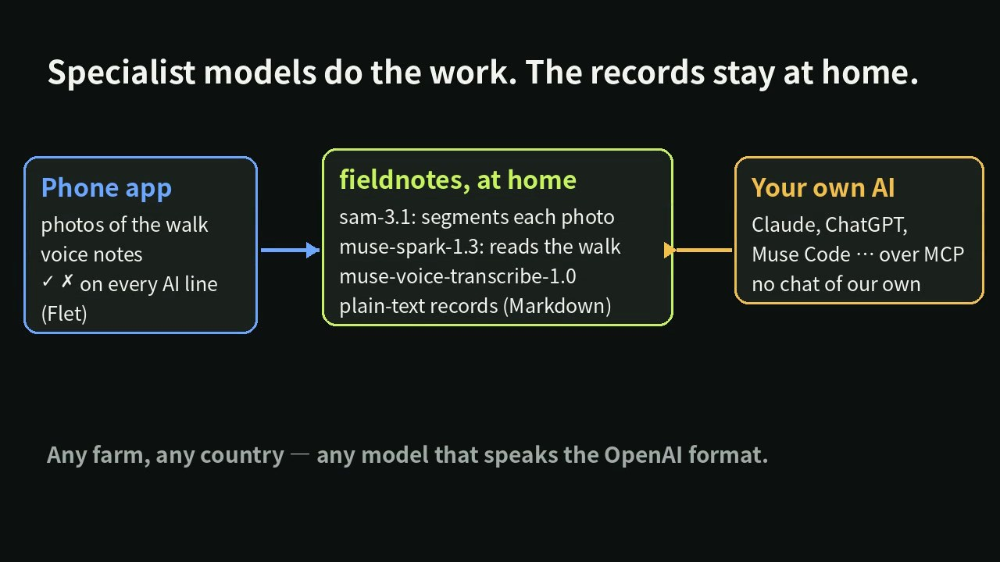
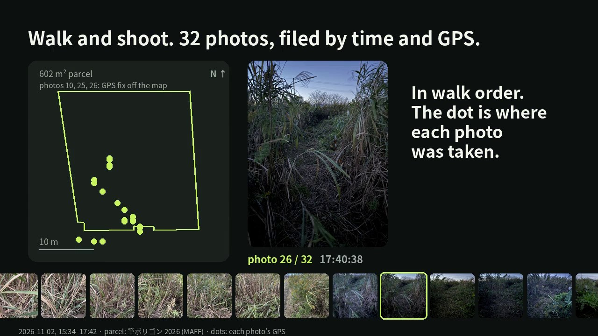
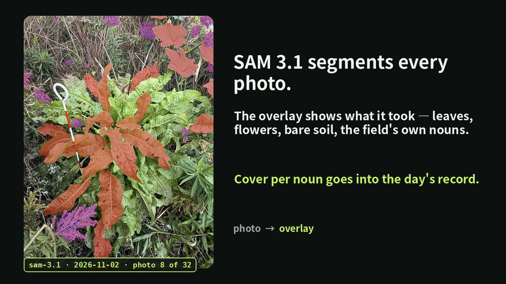
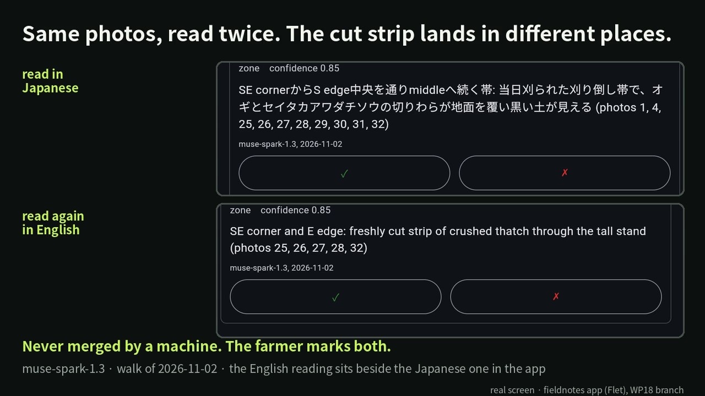
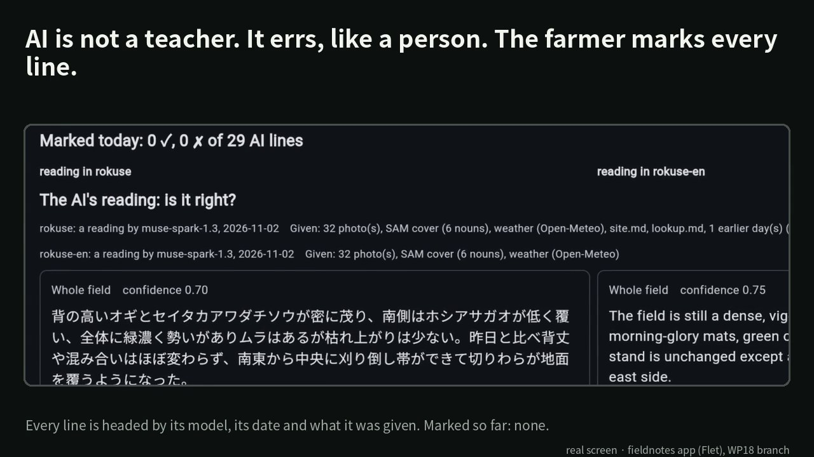
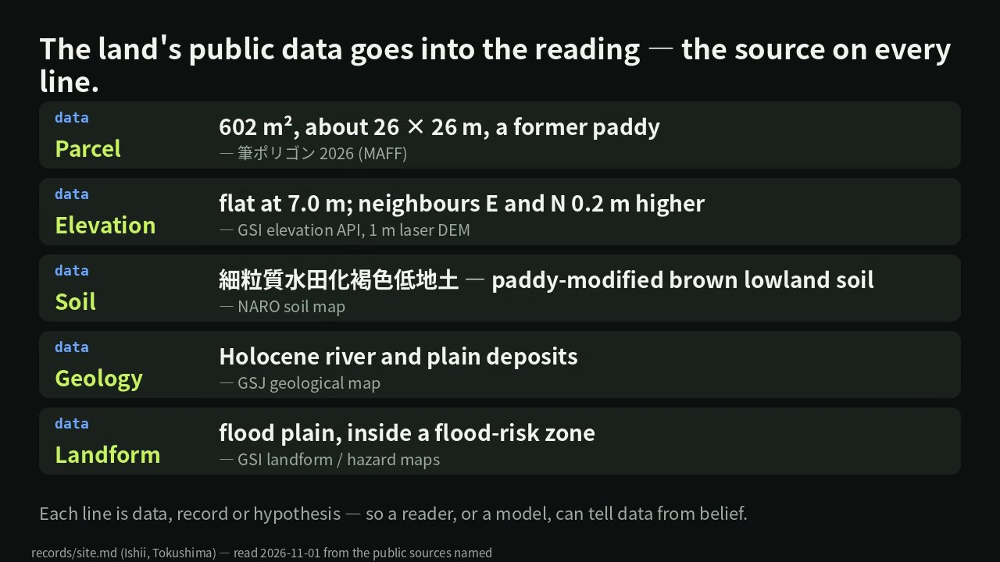
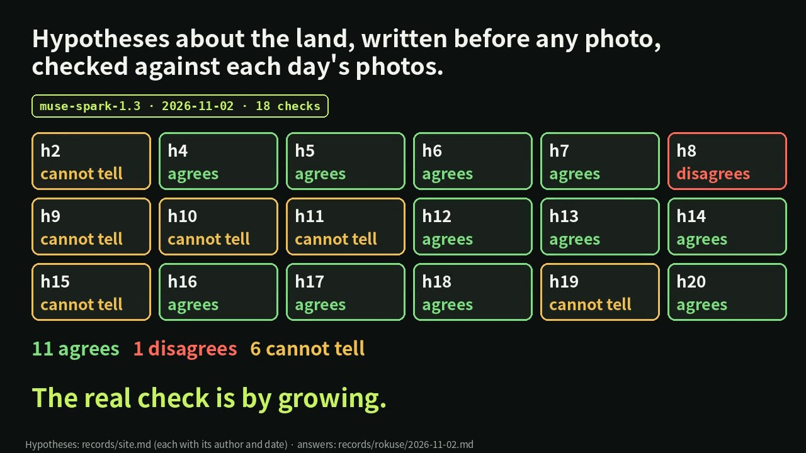
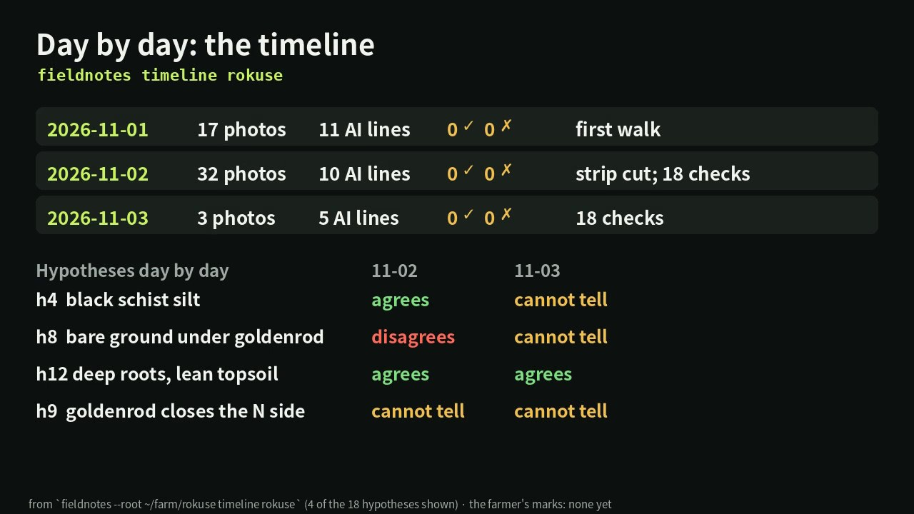

# fieldnotes — read your field from the photos of a walk, with AI

Built for the Meta Global AI Developer Hackathon (26 Oct – 4 Nov 2026), track *Indie Developer*, theme *Build for Your World*. Demo video (3 min): https://youtu.be/xw2kbu5pmWg. Meta's models read a farmer's field; a Flet phone app is where the farmer walks, reads and marks; the records stay at home as plain text.

```bash
pip install "fieldnotes-farm[app,voice]"
```



## Why

Farming today runs on things bought from outside: fertiliser from suppliers, and the know-how to use it from the co-op and the dealers. About 70 % of the world's phosphate rock reserves are in Morocco, and China has restricted phosphate fertiliser exports since 2021. As cheap, steady supply ends, depending on outside inputs becomes the weak point.

The way out is to buy less from outside and rebuild around the field's own strength — roots and mycorrhizal fungi cycling phosphorus. But every field has different soil and different weeds, so no single method can be handed down from above. Instead, AI reads each field — its terrain, geology, weeds and weather — and the farmer looks, works, and checks the AI against what actually happens. It is like open source: you can read the inside, what people learn is kept and shared as records, and now AI helps you read.

My field lies just south of the Median Tectonic Line in Tokushima, a former paddy with a plough pan at 20 cm. I farm it without fertiliser or pesticide because I want to try Masanobu Fukuoka's natural farming, and I want the records to show what it gains and what it loses; the tool takes no side and has no method of its own. It has had no fertiliser for four years; one plot I left uncut for a single year is now goldenrod and Amur silver grass (ogi) taller than I am, grown with nothing brought in. The soil here is rich in minerals; what is missing is the way for plants to take them up themselves. So the tool reads such land and proposes where and how to cut first to bring it back into crops.

Growing is not enough on its own; selling, too, has been handed to the co-op and the wholesale market, and today's distribution does not carry to the buyer how a field was grown. The records this tool keeps — the field's soil and weeds, what was done, how the crops grew, and the farmer's own checks on every reading — are first the ground for growing, and the same records become the ground for a buyer's trust.

## What it does

I walk the field with my phone and take 20–50 photos. Each day:

1. **Segment** — **SAM 3.1** segments every photo into leaves, flower clusters, bare soil and the field's own noun phrases → cover % per concept. On my field the cover came out near zero with the default prompts and right only with scene-level nouns (87 % vegetation over the 32 photos of 11-02, on a copy of the folder); the farmer changes the prompts, the overlays show what SAM took, and the numbers stay in the record as they are.
2. **Read** — **Muse Spark 1.3** (or **Muse Glimmer 30B** at home) reads the whole walk in one request, each photo labelled with where it was taken, against the previous days and the land's public data: which parts of the field differ (`zone`), what sown is coming up (`emerging`), and an answer per hypothesis about the land (`agrees`, `disagrees`, `cannot tell`).
3. **Mark** — every AI line is a reading headed by its model and date, never a fact. I mark each one right or wrong with a reason, by tap, on the command line or from my own AI; the corrections feed the next reading. **Muse Voice Transcribe** is wired in to write down what I say in the field (not yet used on a real recording).
4. **Record** — plain Markdown that any person or model can read; what every file and line means is in [docs/records.md](docs/records.md).







## The phone app

The app is the main way fieldnotes is used; the command line and the MCP server are the same functions, for scripts and for your own AI. It is a Flet app (Python, one code for phone and desktop); on start the PC prints the address and its QR code, the screen is dark for outdoors, and nothing needs a keyboard but the reason box. Manual: [docs/manual.md §4.2](docs/manual.md).

```bash
fieldnotes --root ~/myfarm app           # http://<this machine>:8550, open it on the phone
```

- **Send** — the field and the day, photos and a voice recording from the phone; the walk as a strip in order under the GPS points on the parcel outline.
- **Read** — the photos and the SAM overlays; every AI line one row with ✓ ✗ and a reason; the day's mark count; two readings of the same day side by side. What it cannot show, it says: "No reading yet", "SAM found nothing for these prompts", "Voice not transcribed".
- **Land** — `site.md` and `lookup.md` line by line, each `data` line with its source, the hypotheses checked day by day; and from the phone: start a farm, add a note, the timeline, expectations, a cut or cover-crop proposal.
- **Nouns** — the phrases SAM is asked to find, ✓ ✗ with a replacement.





## Checking hypotheses on the photos

The `hypothesis` lines in `site.md` are things to check, not premises. `fieldnotes expect` has the model write, before it sees any photo, what photos would show for each one; every later reading answers per hypothesis, and `fieldnotes timeline` lays the answers out day by day. Expectations come first so they cannot be bent to fit the photos. The real check is by growing.





## What is not done

- The voice path is built and tested with mocked answers; no real recording has been through it (2026-11-05).
- The AI lines of the walks of 11-01 to 11-03 are read but not yet marked.
- The field was walked on four days (10-27, 11-01, 11-02, 11-03), not daily; the cut proposal of 10-29 is not yet marked.
- Public data per country exists for Japan; elsewhere the world maps only. The sources for the US and Europe are planned ([docs/implementation.md](docs/implementation.md), WP14).

## Meta models used

| Step | Model | How |
|---|---|---|
| Segment | `sam-3.1` | Meta Model API, one concept per request, masks → cover % (`src/fieldnotes/segment.py`) |
| Read | `muse-spark-1.3` | Meta Model API, several days' photos in one request, JSON out (`src/fieldnotes/describe.py`) |
| Read (local) | Muse Glimmer 30B | llama.cpp `llama-server` on a Ryzen AI Max+ 395 box in the house; same code, different `base_url` (`fieldnotes reader glimmer`). So far it answers in English and takes about 212 s a photo |
| Voice | `muse-voice-transcribe-1.0` | the farmer's recordings, in the farmer's language, with the field's plant names as keywords (`src/fieldnotes/voice.py`); Muse Spark then sorts what was said. Not yet used on a real recording |

## Running

```bash
pip install fieldnotes-farm                  # the command line, the records and the MCP server
pip install "fieldnotes-farm[app,voice]"     # plus the phone app (Flet) and the phone's voice recordings (PyAV)
# Meta Model API key (dev.meta.ai → API keys): set MODEL_API_KEY, or keep it in ~/.config/fieldnotes/model_api_key (chmod 600).
```

The package is `fieldnotes-farm` on PyPI; the command and the import are `fieldnotes`. From a checkout: `python -m venv .venv && .venv/bin/pip install -e ".[all]"`; tests run offline with `.venv/bin/pytest`. Manual: [docs/manual.md](docs/manual.md) (日本語: [docs/manual.ja.md](docs/manual.ja.md)); the short page on PyPI: [PYPI.md](PYPI.md).

### Your own farm

A farm is a folder with `photos/` and `records/`. Start it with where it is; everything about the place comes from the `records/site.md` this writes, never from the code, so a farm anywhere can be started:

```bash
mkdir ~/myfarm && cd ~/myfarm
fieldnotes init --place "Nakuru, Kenya" --country KE --lat -0.30 --lon 36.07 --climate "highland, two rainy seasons" --method "ploughed once a year; no herbicide; maize and beans in rotation"
fieldnotes lookup                        # public data for the spot → records/lookup.md, each line with its source
fieldnotes note "the pole goes in about 20 cm"                     # your own words → site.md as a `record` line
fieldnotes note --source "石井町史 (1991) p.833" --section history "..."   # a document's statement → a `data` line
```

`--method` is how the farm is worked, in your own words; leave it out and `site.md` says `not recorded yet`. `lookup` fetches elevation, bedrock, soil and history nearby; in Japan also the national sources: the address, the 1 m elevation and landform class, the nearest active fault, the hazard zones, the 筆ポリゴン farmland parcel, the 産総研 1:50,000 geological map sheet and the 農研機構 soil map. Hypotheses in `site.md` are things to check, not premises.

Data sources used by `lookup` (each line in `records/lookup.md` names its own):

* Open-Meteo elevation API (Copernicus DEM); Macrostrat (CC BY 4.0); 産総研 地質調査総合センター シームレス地質図 V2; ISRIC SoilGrids 2.0; Wikipedia; OpenStreetMap (ODbL); daily weather from the Open-Meteo archive (ERA5, CC BY 4.0).
* 出典：国土地理院（逆ジオコーダ、標高API、ベクトルタイル「地形分類」、活断層図（都市圏活断層図）） — Japan only.
* 出典：ハザードマップポータルサイト（土砂災害警戒区域、洪水浸水想定区域（想定最大規模）） — Japan only.
* 出典：産総研地質調査総合センター 地質図カタログ（5万分の1地質図幅） — Japan only.
* 出典：農研機構、日本土壌インベントリー (CC BY 4.0; terms: 農研機構「デジタル土壌図 活用マニュアル」§3, https://www.naro.go.jp/publicity_report/publication/files/soil_map_manual.pdf). The soil map contains errors. Only the map tiles and the legend NARO serves are used — Japan only.
* 出典：「筆ポリゴンデータ（2026年度公開）」（農林水産省）を加工して作成 (the area and the counts of neighbouring parcels are computed by fieldnotes) — Japan only. The 筆ポリゴン are reference information for the position and shape of farmland; they show neither 筆界 nor any rights.

### The sample farm

`sample/` is the author's field in Tokushima (fields `row1`, `mix1`, `uncut`): single-photo days (10-27, 10-28), the 10-29 cut proposal and the 10-30 expectations, none marked yet; the readings are in Japanese. `sample-en/` is the same farm read again in English, not translated. Try `fieldnotes --root sample app`.

### Daily use

```bash
fieldnotes observe uncut 2026-10-28      # weather → SAM → Muse Spark → records/uncut/2026-10-28.md (+ overlays)
fieldnotes show uncut                    # the latest record
fieldnotes voice uncut memo.m4a          # what you did and saw, or which lines are right or wrong, said aloud
fieldnotes mark uncut 2026-10-28 overall wrong "it is uneven, not even"
fieldnotes concept uncut goldenrod wrong "finds ogi too" --replace "yellow flowers"
fieldnotes expect uncut                  # before any photo: what photos would show for each hypothesis
fieldnotes propose uncut --cut           # where to cut first and how high
fieldnotes propose uncut --seeds "crimson clover, rye"
fieldnotes timeline uncut                # day by day, with the hypotheses table
fieldnotes observe _around               # the neighbourhood: verges, the river bank, abandoned land (no SAM)
fieldnotes reader glimmer --check        # read with Muse Glimmer at home instead of Muse Spark
fieldnotes language en                   # the AI writes in English; `auto`: each phone's or PC's own language
```

`--root DIR` (before the subcommand) points at the farm folder; the default is `$FIELDNOTES_ROOT`, else the current folder. Running `observe` again on the same day replaces the AI lines but keeps your marks and notes. Photos go in `photos/<field>/<date>/`; the day's `index.json` keeps each photo's time, GPS point and heading.

### From your own AI

fieldnotes has no chat screen. You talk to the AI you already use (Claude, ChatGPT, Muse Code ...), and it calls fieldnotes over MCP: `fields`, `read`, `observe`, `say`, `mark`, `propose`, `timeline`, `site`, `note`. Lines marked `→ farmer: right/wrong` are yours; lines without a mark are only the AI's reading, and the server tells your AI to keep the two apart.

```bash
claude mcp add fieldnotes -- /path/to/.venv/bin/fieldnotes --root /path/to/myfarm mcp      # Claude Code
```

Muse Code (`~/.config/muse/settings.json`; see [Extending: MCP servers](https://dev.meta.ai/docs/muse-code/extending)):

```json
{"schema_version": 1,
 "mcp_servers": {"fieldnotes": {"transport": "stdio", "command": "/path/to/.venv/bin/fieldnotes",
                                "args": ["--root", "/path/to/myfarm", "mcp"], "mode": "optional"}}}
```

`fieldnotes mcp --http` serves the same tools on port 8551 for an AI on another machine in the house. No sign-in, like the phone app: keep it on the home network.

## Built during the hackathon

Everything in this repository: `src/fieldnotes/`, `scripts/`, `docs/`, `tests/`, and the sample farm under `sample/` and `sample-en/`. Two things of mine existed before and are not used here: `field-timelapse` (aligns hand-held photos) and a JMA-based weather site. The design and the work log, with what is not done: [docs/implementation.md](docs/implementation.md); the record format: [docs/records.md](docs/records.md); the submission text: [docs/submission.md](docs/submission.md).

## Licence

AGPL-3.0-or-later.
